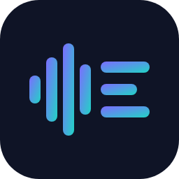
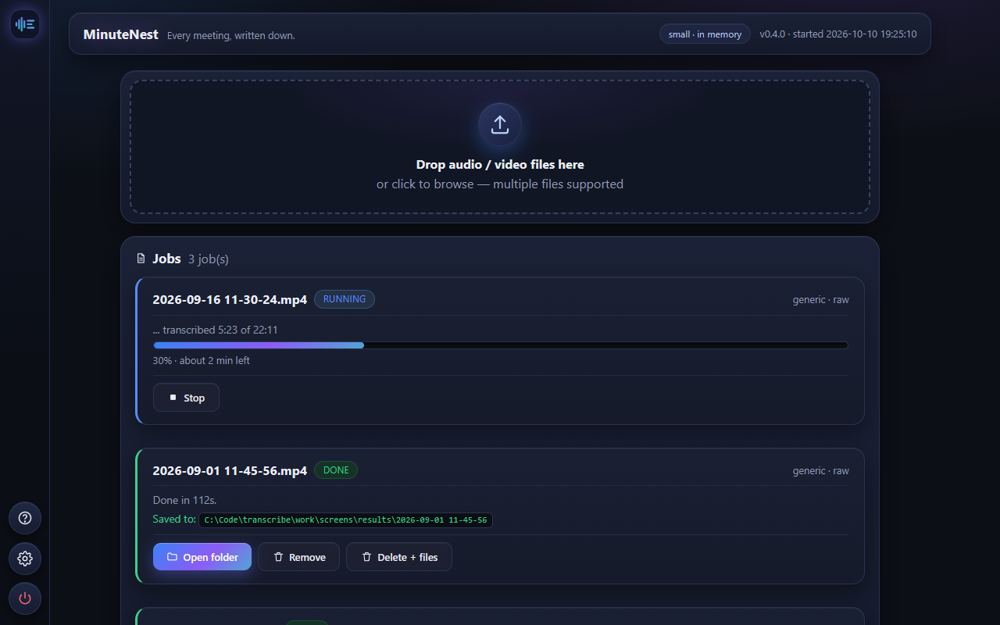
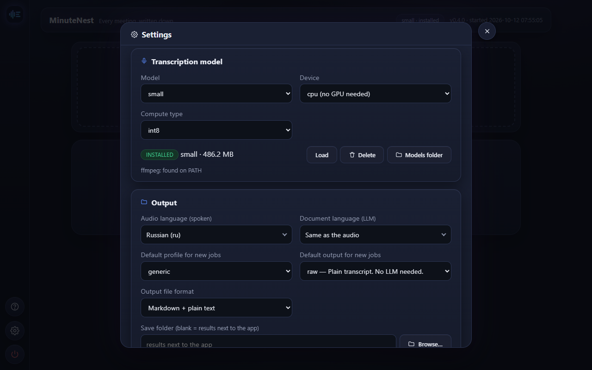

# MinuteNest



**Every meeting, written down.** Drop in a video or audio file and MinuteNest
writes out the transcript, and, if you connect an LLM, notes, action items or a
test plan. Transcription runs on your own computer.



## Getting started

1. Download `MinuteNest-<version>-win64.zip` from Releases and unzip it
   anywhere.
2. Run `MinuteNest.exe`.
3. Follow the setup walkthrough: it walks you through picking a model and the
   language of your recordings, adding a recording, and running it. The
   formatted-output (LLM) step is optional and can be skipped.

No recording handy? "Try with a sample" stages a short built-in clip, so you
can take the whole thing for a spin first.

No installer, no admin rights, no account. The app keeps everything it needs in
its own folder, so deleting the folder removes it completely. Nothing is
written to Documents, Downloads or your user profile — not even the GPU's
kernel cache, which is redirected into the app folder.

The transcription model isn't included in the zip. It's too large to ship
(75 MB to 3 GB depending on the model). You download it once from inside the
app. After that, transcription runs entirely offline; only cloud LLM output
needs an internet connection.

## What it does

| Stage | What happens |
|-------|--------------|
| Extract | Takes the audio out of any video or audio file |
| Transcribe | Turns speech into text using a Whisper model on your GPU (or CPU) |
| Correct | Fixes terms Whisper misheard, using a domain glossary |
| Write (optional) | An LLM turns the transcript into notes, actions, a test plan, or a summary |

The first three stages need nothing but the app. The last stage needs an LLM:
either a local one (Ollama, LM Studio, any OpenAI-compatible server) or a cloud
key (Ollama Cloud, OpenRouter, Anthropic, OpenAI). OpenRouter's free models
are often busy; when the one you picked is, another free model writes the
document and the job says which. If you only need plain
transcripts, you can skip the LLM entirely.

Two languages are set separately: the **audio language** is the one people
speak in the recording (Whisper needs it to transcribe), the **document
language** is the one the LLM writes in. By default the document follows the
audio; set it to English, for example, to get English notes of a Russian
meeting. The transcript itself always stays in the language that was spoken.

A run can be stopped from its job card; cancelled jobs stay in the list and
can be started again.

## Transcript quality

Whisper often mishears technical words. A recording about SCADA tools, for
example, comes out with "скандала" instead of "SCADA". MinuteNest fixes this
with a glossary per domain: 14 profiles (software, business, medical, legal,
finance, education, science, marketing, support, HR, dashboard, SCADA, MES,
generic); the common ones ship dictionaries in up to 6 languages
(RU/EN/ES/DE/FR/PT). The right language variant loads from the audio language
automatically, and you can change profile or language per file.

Raw output before correction:

```
мы используем скандала для мониторинга
```

After correction:

```
мы используем SCADA для мониторинга
```

## Accuracy and speed

Measured with the app's own settings (Whisper large-v3, RTX 5060 Laptop GPU,
8 GB). WER is the share of words wrong, lower is better; punctuation and case
are ignored, numbers written as digits instead of words count as errors.

| Recording | WER | Transcription time |
|-----------|-----|--------------------|
| Russian, read speech (FLEURS, 30 min) | 3.6% | 2.3 min |
| Russian, conversational IT podcast (12 min) | 7.0% | 1.2 min |
| German / Spanish / French, read speech (FLEURS, 10 min each) | 5.5% / 3.1% / 8.4% | under 1 min each |
| English, read speech (FLEURS, 10 min) | 7.5% | about 0.5 min |

Whisper understands about 100 languages, but quality varies: Ukrainian came out
at 17% and Armenian at 57% (not usable).

## Results

Each job writes its files into its own folder under `results/`:

- `<name>.txt`: the transcript after glossary correction
- `<name>.raw.txt`: the transcript as Whisper produced it — only when the
  profile's glossary actually changed something (otherwise it is identical to
  the `.txt` and is not written)
- `<name>.json`: segments with timestamps (start, end, text)
- `<name>.<task>.md` and/or `<name>.<task>.txt`: the formatted document.
  Pick Markdown, plain text or both in Settings or per job. For `raw` jobs it's
  a timestamped transcript (`<name>.raw.md`; with plain text alone, the `.txt`
  transcript is the text version); for formatted output it's the LLM
  document (`notes`, `actions`, `testplan`, …).

If the LLM refuses on a very garbled recording, the job fails — but the
transcript and segments above are written before the LLM stage, so they are
always in the job's folder.

## Command line

`minutenest-cli.exe` does the same work without a window, for scripts and
automation:

```powershell
minutenest-cli run meeting.mp4 --task raw --json
```

It supports `--json` output and stable exit codes (0 = success, 1 = usage
error, 2 = processing error). The full list of commands, flags, and recipes is
in [AGENTS.md](AGENTS.md).



## Requirements

- Windows 10 or 11, 64-bit
- An NVIDIA GPU is recommended. Without one, transcription runs on the CPU and
  the app starts with the `small` model: on a 16-thread laptop CPU it takes about
  a sixth of the recording's length (large-v3 on the same CPU: about 80%).

## Development

Setup and test instructions are in [CONTRIBUTING.md](CONTRIBUTING.md); the coding
and quality standards the code is checked against are in [QUALITY.md](QUALITY.md).

## Privacy

Transcription runs on your computer. Your recordings never leave it. MinuteNest has no
telemetry, no accounts and no update checks. The only network traffic is:

- downloading a Whisper model from Hugging Face when you ask for it, and
- the text of a transcript, sent to the LLM provider **you** configure
  (Anthropic, OpenAI, OpenRouter, another OpenAI-compatible service, or Ollama), only
  when you run a task that uses one. Pick Ollama on your own machine to keep
  everything local. API keys are stored in plain text in the app's local settings file next to the
  program (not encrypted) and are never logged.

Recordings of other people can be personal data and may need their consent where you
live. That responsibility is yours.

## License

MinuteNest is free and open source under the [MIT License](LICENSE). It is provided
"as is", without warranty of any kind.

The Windows release also bundles third-party software (FFmpeg, NVIDIA CUDA runtime
libraries and Python packages) under their own licences. See
[THIRD_PARTY_NOTICES.md](THIRD_PARTY_NOTICES.md).

